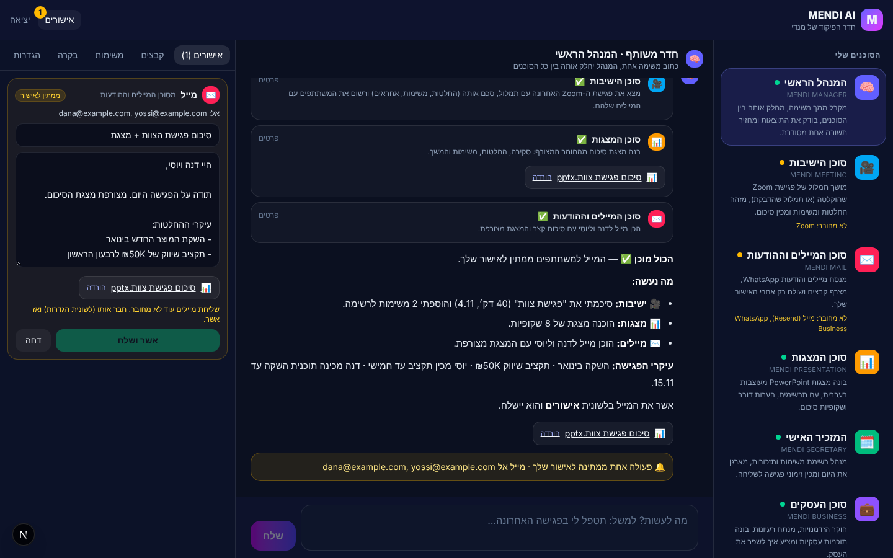
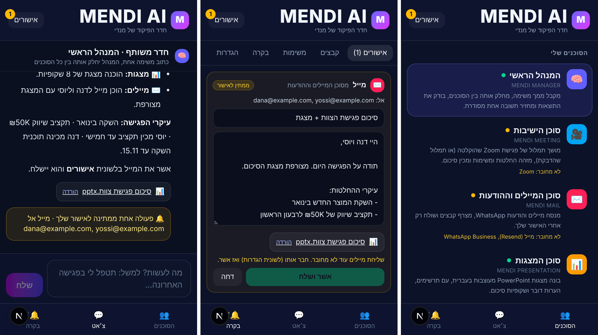
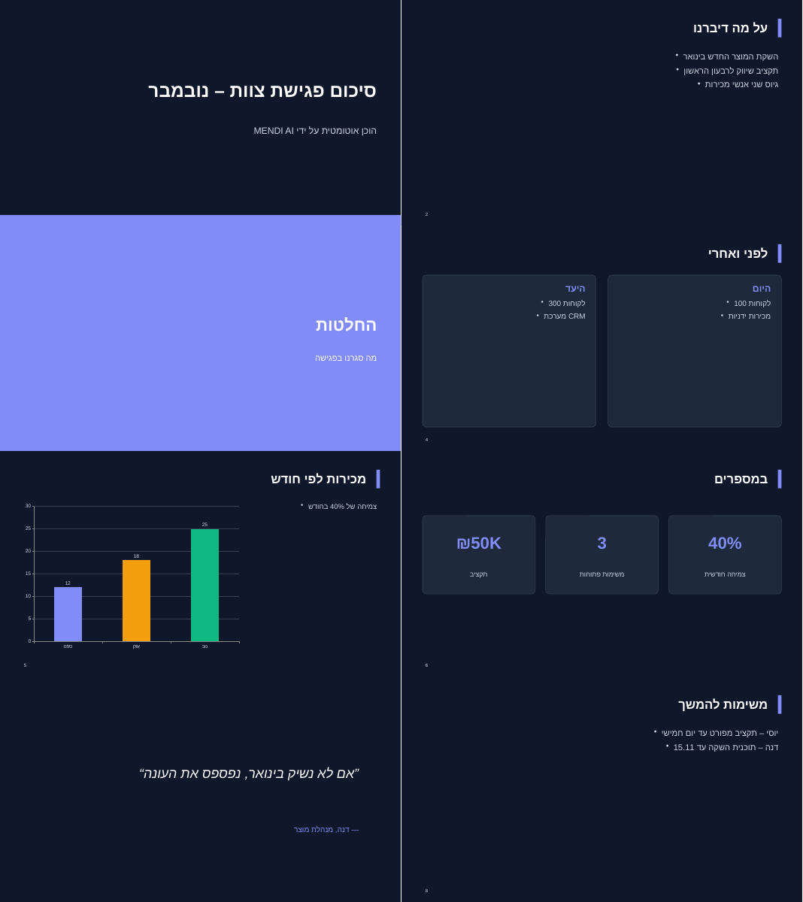

# MENDI AI · חדר הפיקוד

צוות של 10 סוכני AI שעובדים בשבילך. אתה המנהל: כותב משימה אחת למנהל הראשי, והוא מחלק אותה בין הסוכנים,
בודק את התוצאות ומחזיר תשובה אחת מסודרת. נכנסים בכתובת **`/mendi`** באתר, מהמחשב או מהטלפון.

## מה כבר עובד

| סוכן | מה הוא עושה בפועל |
| --- | --- |
| 🧠 המנהל הראשי | מפרק משימה לשלבים, מעביר כל שלב לסוכן המתאים (גם כמה במקביל), בודק ומסכם |
| 🎥 ישיבות | מוצא פגישה מוקלטת ב-Zoom, קורא את התמלול והמשתתפים, מסכם החלטות ומשימות. בלי Zoom: מסכם תמלול שהודבק |
| ✉️ מיילים והודעות | מנסח מיילים והודעות WhatsApp עם קבצים מצורפים, ושולח רק אחרי אישור |
| 📊 מצגות | בונה מצגת PowerPoint מעוצבת בעברית (מימין לשמאל), עם תרשימים, השוואות, מספרים והערות דובר |
| 🗓️ מזכיר | רשימת משימות ותזכורות, סידור היום, זימוני פגישה (‎.ics) לשליחה במייל |
| 💼 עסקים · 🔎 מחקר · 📣 שיווק | מחפשים ברשת עם מקורות, מנתחים, כותבים תוכניות, פוסטים וקמפיינים |
| 💰 כספים | מסדר נתונים בטבלה שנפתחת באקסל, מנתח הכנסות, הוצאות ותקציב |
| 🤝 שירות לקוחות | מנסח תשובות ללקוחות ושולח בוואטסאפ או במייל אחרי אישור, ומעביר אליך מקרים מורכבים |

**התרחיש המרכזי:** כותבים למנהל "תטפל לי בפגישה האחרונה: תסכם אותה, תכין מצגת ותשלח אותה למשתתפים".
סוכן הישיבות מסכם, סוכן המצגות בונה מצגת, סוכן המיילים מכין מייל למשתתפים עם המצגת, והמייל מחכה בלשונית
**אישורים**. אפשר לערוך אותו, ללחוץ "אשר ושלח", והוא יוצא פעם אחת בלבד.

## עצמאות ואישורים

- ברירת המחדל: הסוכנים עושים הכול, אבל **כל מייל והודעה מחכים לאישור שלך**.
- בלשונית **הגדרות** אפשר לאשר מראש סוג פעולה (מייל או WhatsApp). הוא ייצא לבד **רק** לנמענים שברשימה
  המהימנה. לכל נמען אחר תמיד תתבקש אישור, כך שתמלול או מייל זדוני לא יכולים לגרום לסוכן לשלוח לזרים.
- לשונית **בקרה** מראה מה כל סוכן עשה ומתי. כל אישור, דחייה ושליחה נרשמים גם ביומן הביקורת של החשבון.
- המשימות רצות ברקע: אפשר לסגור את הדף ולחזור, גם ממכשיר אחר.

## חיבורים (משתני סביבה ב-Netlify)

| שירות | משתנים | הערות |
| --- | --- | --- |
| המוח (חובה) | `ANTHROPIC_API_KEY` | |
| Zoom | `ZOOM_ACCOUNT_ID`, `ZOOM_CLIENT_ID`, `ZOOM_CLIENT_SECRET` | אפליקציית Server-to-Server OAuth. להפעיל ב-Zoom הקלטה בענן ו-Audio transcript |
| מייל | `RESEND_API_KEY`, `MENDI_EMAIL_FROM` | דומיין מאומת ב-Resend |
| WhatsApp | `WHATSAPP_TOKEN`, `WHATSAPP_PHONE_NUMBER_ID` | WhatsApp Business Cloud API. הודעה חופשית מגיעה רק למי שכתב לעסק ב-24 השעות האחרונות; מעבר לזה צריך תבנית מאושרת |

בלי חיבור, הסוכן עדיין עובד על מה שמדביקים לו, ובחדר הפיקוד רואים בדיוק מה חסר.

## פרטיות והסכמה

התמלול מגיע מהקלטת הענן של Zoom עצמה, שמודיעה לכל המשתתפים שהפגישה מוקלטת. המערכת לא מאזינה בסתר.

## מה עוד לא נבנה (השלבים הבאים)

1. **סוכן שמצטרף לפגישה בזמן אמת** כמשתתף מזוהה (Zoom Meeting SDK / RTMS), במקום עבודה מההקלטה אחרי הפגישה.
2. **קריאת תיבת הדואר** (Gmail API עם התחברות Google) כדי שסוכן המיילים יסכם מיילים נכנסים.
3. **יומן אמיתי** (Google Calendar) כדי שהמזכיר יבדוק זמינות ויקבע פגישות ישירות.
4. **WhatsApp נכנס**: webhook שמעביר הודעות לקוחות לסוכן השירות, ולך: לדבר עם המנהל דרך WhatsApp.
5. **שיחות קוליות** עם הסוכנים (שירות Voice AI).
6. תמונות במצגות (חיבור לסטודיו ה-AI שכבר קיים באתר).

